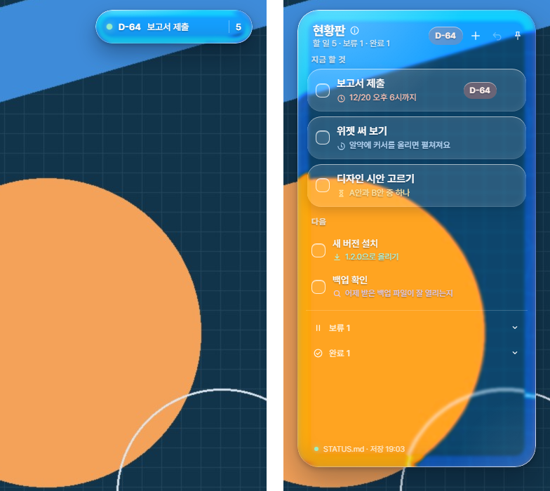

# 현황판 위젯

**[한국어](#한국어) · [English](#english)**



## 한국어

할 일 목록(`STATUS.md` 파일 하나)을 바탕화면 오른쪽 위에 Liquid Glass 느낌의 위젯으로 띄워 두는 Windows용 프로그램입니다. 평소에는 작은 알약 모양으로 접혀 있다가, 커서를 올리면 펼쳐집니다.

Claude Code와 함께 쓰면 Claude도 같은 파일을 읽고 고치기 때문에, Claude가 맡은 일과 직접 할 일이 한 목록에 모입니다. Claude가 여러 단계로 하는 일은 프로젝트 탭에 단계와 진행도로 보여서, 앱을 열지 않아도 어디까지 왔는지 알 수 있습니다. Claude 없이 평범한 할 일 위젯으로 써도 괜찮습니다.

**목차**
- [할 수 있는 것](#할-수-있는-것)
- [설치하기](#설치하기)
- [쓰는 법](#쓰는-법)
- [Claude Code와 같이 쓰기](#claude-code와-같이-쓰기)
- [Claude 없이 쓰기](#claude-없이-쓰기)
- [파일 형식](#파일-형식)
- [알아 두면 좋은 점](#알아-두면-좋은-점)
- [고치고 싶은 분께](#고치고-싶은-분께)
- [라이선스](#라이선스)

### 할 수 있는 것

- 위 3개는 **"지금 할 것"** 카드로 크게, 나머지는 순위대로 아래에 보여 줍니다.
- 마감이 있는 일에는 **D-5**처럼 남은 날짜가 붙습니다.
- 네모를 체크하면 줄이 그어지고, **빗자루** 버튼을 누르면 줄 그은 일이 한꺼번에 완료함으로 옮겨집니다.
- 줄을 **잡고 끌어서** 순서를 바꿀 수 있습니다. 보류나 완료 칸 위에 놓으면 그 칸으로 들어갑니다.
- **⋯ 버튼이나 오른쪽 클릭**으로 "지금 할 것으로 올리기 · 보류 · 완료"를 고를 수 있습니다.
- **+ 버튼**으로 새 일을 넣습니다. 종류를 고르고 Enter를 누르면 됩니다. **달력**으로 날짜도 정할 수 있습니다.
- 단계가 여러 개인 일은 **프로젝트 탭**에 단계 목록으로 보입니다. 지금 하는 단계와 다음 단계가 표시되고, 끝난 단계는 체크합니다.
- 맨 위 프로젝트가 얼마나 됐는지 펼친 판 맨 위와 접힌 알약에 **얇은 줄과 %**로 보입니다.
- 날짜를 정한 일은 때가 되면 **알약 밑에 알림**이 뜹니다. 일정은 네모 칸으로, "진행해 볼까요?" 같은 질문은 말풍선으로 뜹니다.
- 완료함에서 **되살리거나 영구 삭제**할 수 있고, 실수했을 때는 **되돌리기** 버튼으로 돌아갑니다.
- 바꾼 내용은 곧바로 `STATUS.md`에 저장됩니다. 메모장으로 파일을 고쳐도 위젯이 몇 초 안에 따라 바뀝니다.

### 설치하기

Windows 10·11에서 쓸 수 있습니다.

1. [Node.js](https://nodejs.org/ko)의 **LTS 버전**을 설치합니다. 설치 화면에서는 "다음"만 눌러도 됩니다.
2. 이 페이지 위쪽의 초록색 **Code → Download ZIP**으로 내려받아, 원하는 곳에 압축을 풉니다.
3. 압축을 푼 폴더를 열고, 위쪽 주소창에 `powershell`이라고 입력한 뒤 Enter를 누릅니다. 그 폴더에서 파란 창이 열립니다.
4. 그 창에 아래 명령을 붙여 넣고 Enter를 누릅니다. 위젯을 그리는 프로그램(Electron, 약 160MB)을 내려받느라 1~2분쯤 걸립니다.

   ```
   npm install
   ```

5. 다 끝나면 폴더 안의 **`현황판 실행.cmd`**를 더블클릭합니다. 화면 오른쪽 위에 알약이 나타납니다.
6. 컴퓨터를 켤 때마다 자동으로 띄우고 싶다면, 작업 표시줄 오른쪽 아래의 **체크 모양 아이콘을 오른쪽 클릭해서 "로그인할 때 자동 실행"**을 켜 주세요.

> 처음 실행할 때 Windows 보안 경고가 뜨면 "추가 정보 → 실행"을 누르면 됩니다.

이미 쓰고 있던 분은 새 파일로 덮어쓰고 위젯을 다시 켜면 됩니다. `npm install`을 다시 할 필요는 없습니다.

### 쓰는 법

| 하고 싶은 것 | 방법 |
|---|---|
| 잠깐 보기 | 알약에 커서를 올립니다. 커서를 치우면 다시 접힙니다. |
| 펼친 채로 두기 | 알약을 **누릅니다**. 다른 창 위에도 떠 있습니다. 위쪽의 **˄**를 누르면 다시 자동으로 접힙니다. |
| 줄 긋기 | 네모 칸을 누릅니다. |
| 완료함으로 보내기 | 빗자루 버튼(줄 그은 것 한꺼번에), 또는 ⋯ → 완료로 |
| 순서 바꾸기 | 줄을 잡고 끕니다. |
| 보류 | ⋯ → 보류, 또는 줄을 "보류" 위에 놓습니다. |
| 새 일 넣기 | + 버튼 → 내용을 쓰고 Enter |
| 날짜 넣기 | + 버튼 → 오른쪽의 달력 버튼 → 날짜를 고른 뒤 **종**(알림만) 또는 **말풍선**(물어보기)을 고릅니다. |
| 프로젝트 보기 | 위쪽 탭에서 프로젝트를 누릅니다. 탭은 프로젝트가 하나라도 있을 때만 보입니다. 카드를 누르면 단계가 펼쳐집니다. |
| 단계 끝내기 | 단계 앞 네모를 누릅니다. 지금 하던 단계를 끝내면 다음 단계가 "지금"이 됩니다. |
| 알약에 띄울 프로젝트 바꾸기 | 카드에 커서를 올리면 나오는 **↥** 버튼으로 맨 위에 올립니다. |
| 알림 닫기 | 네모 알림은 ✓나 ×, 말풍선은 "내일"(내일 다시 알림)이나 × |
| 위젯 옮기기 | "현황판" 글자를 잡고 끕니다. |
| 파일 직접 열기 | 맨 아래 파일 이름을 누릅니다. |
| 유리 색 바꾸기 | 오른쪽 아래 톱니를 누르고 색을 고릅니다. 무지개 동그라미를 누르면 팔레트나 색 코드(예: `#7ab8e6`)로 직접 정할 수 있습니다. 알림도 같은 색을 따라갑니다. |
| 끄기 | 체크 모양 아이콘 오른쪽 클릭 → 끝내기 |

체크 모양 아이콘 메뉴에는 항상 위에 두기, 펼친 채로 두기(다음에 켤 때도 유지), 다른 현황판 파일 고르기, 새 현황판 만들기, 위치 처음으로, 다시 그리기도 있습니다.

### Claude Code와 같이 쓰기

컴퓨터에 `C:\Users\(내 이름)\.claude` 폴더가 있으면, 위젯은 **`~/.claude/STATUS.md`** 를 현황판으로 씁니다. 파일이 없으면 예시 내용으로 새로 만듭니다.
Claude가 매번 이 파일을 보고 고치게 하려면, `~/.claude/CLAUDE.md`(없으면 새로 만듭니다)에 아래 내용을 붙여 넣으면 됩니다.

```markdown
## 작업 현황판
- 지금 걸려 있는 일은 `~/.claude/STATUS.md`에 있다. 바탕화면 위젯이 이 파일을 읽고 쓴다.
- 일을 새로 맡거나, 끝내거나, 막히면 이 파일도 같이 고친다. 사용자가 위젯으로 바꿨을 수 있으니 고치기 전에 다시 읽는다.
- 형식은 파일 맨 위 규칙을 따른다. 끝난 일은 줄을 지우지 않고 `[x]`로 바꾸고 `(완료 MM/DD)`를 붙여 `## 완료` 맨 위로 옮긴다.
- 새 일은 우선순위를 판단해 알맞은 자리에 넣는다. 애매하면 위 3개 바로 아래에 넣는다.
- 단계가 셋 이상인 일은 `## 프로젝트`에 단계 목록(`[x]` 끝남, `[>]` 지금, `[ ]` 남음)을 만든다. 단계를 시작하거나 끝낼 때마다 그 자리에서 바로 고치고, 지금 하는 프로젝트를 맨 위에 둔다.
- 설명 끝에 `M/D 추가`가 붙은 줄은 내가 위젯에 직접 적어 둔 메모다. 참고로만 보고 먼저 실행하지 않는다.
- 그 줄이 `물어보기`이고 날짜가 사흘 안으로 들어왔으면, 대화 중에 하던 답이 끝날 때 한 번 묻고 줄 끝에 `· M/D 물어봄`을 붙인다. `알림만`이면 묻지 않는다.

@~/.claude/STATUS.md
```

마지막 줄의 `@~/.claude/STATUS.md`는 Claude Code가 새 세션을 열 때마다 현황판 내용을 함께 읽게 해 줍니다. 그래서 세션이 바뀌어도 Claude가 같은 목록을 알고 이어서 고칩니다.

말풍선 알림의 **"Claude에서 열기"** 를 누르면 Claude 데스크톱 앱의 Code 탭에 새 대화가 열리고, "현황판에 넣어 둔 ○○ 진행해 보자" 같은 문장이 입력칸에 미리 들어가 있습니다. 보내기는 직접 누릅니다. Claude 데스크톱 앱이 깔려 있어야 하고, 앱이 작업 폴더(현황판 파일이 있는 폴더)를 써도 되는지 확인을 물을 수 있습니다.

### Claude 없이 쓰기

`.claude` 폴더가 없으면 **`문서\현황판\STATUS.md`** 를 예시 내용으로 만들어서 씁니다.
다른 위치의 파일을 쓰고 싶다면 아이콘 메뉴의 **"다른 현황판 파일 고르기…"** 나 **"새 현황판 만들기…"** 를 누르면 됩니다. 고른 파일은 다음에 켤 때도 기억합니다.

프로젝트는 파일에 직접 적으면 똑같이 보입니다. 필요 없으면 예시의 `## 프로젝트` 칸을 지우면 되고, 그러면 탭도 사라집니다. 날짜를 넣을 때는 **알림만**을 고르면 됩니다.

### 파일 형식

```markdown
## 프로젝트
- [ ] [진행] 이사 준비 — 11월 말 이사
  - [x] 집 계약하기
  - [>] 버릴 짐 정리하기
  - [ ] 주소 옮기기

## 할 일
- [ ] [마감] 보고서 제출 — 12/20 오후 6시까지
- [ ] [대기] 친구 생일 선물 — 1/1 추가 · 날짜 12/24 · 알림만

## 보류
- [ ] [대기] 책장 정리 — 주말에

## 완료
- [x] [진행] 현황판 위젯 설치 (완료 1/1)
```

- 칸은 `## 프로젝트`, `## 할 일`, `## 보류`, `## 완료`입니다. `## 프로젝트`는 없어도 됩니다. `## 할 일`은 **위에 있을수록 먼저** 할 일입니다.
- 한 줄은 `- [ ] [태그] 제목 — 설명 ← 참고` 모양입니다. 태그는 **마감 · 진행 · 대기 · 설치 · 확인** 중 하나이고, 설명과 참고는 없어도 됩니다.
- `[마감]` 줄은 처음 나오는 날짜(월/일)로 D-day를 셉니다.
- 프로젝트 줄 밑에 두 칸 들여 쓴 줄이 단계입니다. `[x]`는 끝남, `[>]`는 지금 하는 단계, `[ ]`는 남은 단계입니다.
- 위젯의 +로 넣은 줄에는 `1/1 추가`처럼 넣은 날이 붙고, 날짜를 고르면 `· 날짜 12/24 · 알림만`(또는 `물어보기`)도 붙습니다.
- 자세한 규칙은 [`STATUS.example.md`](STATUS.example.md) 맨 위에 있습니다.

### 알아 두면 좋은 점

- 유리 너머로 비치는 그림은 **바탕화면 그림을 위젯 안에 맞춰 깔아서** 만든 것입니다. 색은 빼고 흑백으로만 비쳐서, 바탕화면이 무슨 색이든 위젯은 고른 유리 색으로 보입니다. "항상 위에 두기"로 다른 창 위에 띄우면, 그 창 대신 바탕화면의 모양이 비쳐 보입니다.
- 날짜 알림은 위젯이 켜져 있을 때 접힌 알약 밑에 뜹니다. 판을 펼치면 잠시 숨습니다. 확인하거나 닫은 알림은 다시 뜨지 않습니다.
- 글꼴은 인터넷에서 [프리텐다드](https://github.com/orioncactus/pretendard)를 불러옵니다. 인터넷이 안 되면 맑은 고딕으로 보입니다.
- 켜 두면 메모리를 약 130MB 씁니다.
- 투명한 부분이 하얗게 변하면 아이콘 메뉴의 **"다시 그리기"** 를 눌러 주세요. 무슨 일이 있었는지는 `%APPDATA%\현황판 위젯\events.log`에 남습니다.
- 파일을 바꿀 때마다 바로 전 내용이 `STATUS.md.bak`으로 남습니다.

### 고치고 싶은 분께

| 파일 | 하는 일 |
|---|---|
| `main.js` | 창, 트레이 메뉴, 파일 읽고 쓰기, 바탕화면 그림, Claude 앱 열기 |
| `status.js` | `STATUS.md` 읽기·쓰기와 각 동작(체크, 옮기기, 완료, 단계 체크 등) |
| `index.html` · `widget.css` · `widget.js` | 위젯 화면 (탭, 프로젝트 카드, 달력, 알림 포함) |
| `preload.js` | 화면과 `main.js` 사이 연결 |

`npm start`로도 켤 수 있습니다. 이때는 검은 창이 같이 뜹니다.

### 라이선스

[MIT](LICENSE) © livj1204 — 자유롭게 쓰고, 고치고, 다시 나눠도 됩니다. 다만 `LICENSE` 파일의 저작권 문구는 남겨 주세요.

[↑ 맨 위로](#현황판-위젯)

---

## English

A small Windows widget that pins your to-do list — a single `STATUS.md` file — to the top-right corner of your desktop with a Liquid Glass look. It stays folded into a small pill and opens when you hover over it.

It's built to work with Claude Code: Claude reads and edits the same file, so what Claude is working on and what you need to do end up in one list. Multi-step work shows up in a Projects tab with its steps and progress, so you can see how far along it is without opening the app. It also works fine as a plain to-do widget without Claude.

> The widget's interface is in Korean. The tables below explain every button.

**Contents**
- [Features](#features)
- [Install](#install)
- [How to use](#how-to-use)
- [Using it with Claude Code](#using-it-with-claude-code)
- [Using it without Claude](#using-it-without-claude)
- [File format](#file-format)
- [Good to know](#good-to-know)
- [For developers](#for-developers)
- [License](#license)

### Features

- The top three items are shown as large **"지금 할 것" (Now)** cards; the rest follow in priority order.
- Items with a deadline get a countdown like **D-5**.
- Tick a box to strike the item through; the **broom** button then moves every struck item to 완료 (Done) at once.
- **Drag** a row to reorder it, or drop it on 보류 (On hold) or 완료 (Done).
- The **⋯ button or a right-click** lets you move an item to Now, put it on hold, or mark it done.
- The **+ button** adds an item: pick a category and press Enter. A **calendar** lets you give it a date.
- Multi-step work appears in the **Projects tab** as a list of steps. The current and next steps are marked, and you tick steps off as they're done.
- The top project's progress shows as a **thin line with a percentage** at the top of the board and on the folded pill.
- Dated items get a **reminder under the pill** when the day comes close: plain reminders in a box, and questions like "Shall we get started?" in a speech bubble.
- In Done you can **restore or permanently delete** items, and the **undo** button reverts your last change.
- Every change is saved to `STATUS.md` right away. If you edit the file in a text editor, the widget catches up within a few seconds.

### Install

Works on Windows 10 and 11.

1. Install the **LTS version** of [Node.js](https://nodejs.org/en).
2. Click the green **Code → Download ZIP** button at the top of this page and unzip it anywhere.
3. Open the unzipped folder, type `powershell` in the address bar, and press Enter. A PowerShell window opens in that folder.
4. Paste the command below and press Enter. It downloads Electron (about 160 MB), which takes a minute or two.

   ```
   npm install
   ```

5. When it's done, double-click **`현황판 실행.cmd`** ("Run Status Board"). A pill appears in the top-right corner.
6. To start it every time you sign in, **right-click the check-mark icon in the system tray** (bottom-right of the taskbar) and turn on **"로그인할 때 자동 실행"** (Start at sign-in).

> If Windows shows a security warning the first time, click "More info → Run anyway".

Updating from an earlier version? Overwrite the files with the new ones and restart the widget. You don't need to run `npm install` again.

### How to use

| To… | Do this |
|---|---|
| Take a quick look | Hover over the pill. It folds back when you move away. |
| Keep it open | **Click** the pill. It also stays on top of other windows. Click **˄** at the top to go back to auto-fold. |
| Strike an item | Click its checkbox. |
| Mark as done | Broom button (all struck items at once), or ⋯ → 완료로 (Done) |
| Reorder | Drag the row. |
| Put on hold | ⋯ → 보류 (Hold), or drop the row on "보류". |
| Add an item | + button → type → Enter |
| Add a date | + button → the calendar button on the right → pick a day, then choose the **bell** (알림만, reminder only) or the **speech bubble** (물어보기, ask me). |
| See projects | Click 프로젝트 (Projects) in the tabs at the top. The tabs only appear once there's at least one project. Click a card to expand its steps. |
| Finish a step | Click the box in front of it. Finishing the current step makes the next one current. |
| Choose the project on the pill | Hover over a card and click **↥** to move it to the top. |
| Dismiss a reminder | Box: ✓ or ×. Bubble: 내일 (remind me tomorrow) or ×. |
| Move the widget | Drag the "현황판" title. |
| Open the file | Click the file name at the bottom. |
| Change the glass color | Click the gear at the bottom right and pick a color. The rainbow circle lets you set your own with a palette or a color code (e.g. `#7ab8e6`). Reminders follow the same color. |
| Quit | Right-click the tray icon → 끝내기 (Quit) |

The tray menu also has 항상 위에 두기 (Always on top), 펼친 채로 두기 (Keep open, remembered across restarts), 다른 현황판 파일 고르기 (Choose another board file), 새 현황판 만들기 (New board), 위치 처음으로 (Reset position), and 다시 그리기 (Redraw).

### Using it with Claude Code

If a `C:\Users\<you>\.claude` folder exists, the widget uses **`~/.claude/STATUS.md`** and creates it from the example if it's missing.
To have Claude read and update it in every session, paste this into `~/.claude/CLAUDE.md` (create the file if you don't have one):

```markdown
## Status board
- My current tasks live in `~/.claude/STATUS.md`. A desktop widget reads and writes this file.
- When you take on, finish, or get stuck on a task, update this file too. Re-read it before editing — I may have changed it in the widget.
- Follow the rules at the top of the file. Don't delete finished items: change `[ ]` to `[x]`, add `(완료 MM/DD)`, and move the line to the top of `## 완료`.
- Put new items where they belong by priority; if unsure, right below the top three.
- For work with three or more steps, add a step list under `## 프로젝트` (`[x]` done, `[>]` current, `[ ]` to do). Update it right away whenever you start or finish a step, and keep the project you're working on at the top.
- Lines ending in `M/D 추가` are notes I added myself in the widget. Treat them as reference only; don't act on them unprompted.
- If such a line says `물어보기` and its date is within three days, ask me about it once, at the end of a reply during our conversation, then append `· M/D 물어봄`. Don't ask about `알림만` lines.
- Keep the Korean section names, tags, and markers — the widget only recognizes those.

@~/.claude/STATUS.md
```

The last line, `@~/.claude/STATUS.md`, makes Claude Code load the board at the start of every session, so Claude knows the same list and keeps it up to date across sessions.

Clicking **"Claude에서 열기"** (Open in Claude) on a bubble reminder opens a new conversation in the Code tab of the Claude desktop app, with a sentence like "Let's get started on … from the board" already in the input box. You press send yourself. This needs the Claude desktop app, which may ask you to confirm the working folder (the folder your board file is in).

### Using it without Claude

Without a `.claude` folder, the widget creates **`Documents\현황판\STATUS.md`** from the example.
To use a different file, choose **"다른 현황판 파일 고르기…"** (Choose another board file) or **"새 현황판 만들기…"** (New board) from the tray menu. Your choice is remembered.

Projects work the same when you write them in the file yourself. If you don't need them, delete the `## 프로젝트` section from the example and the tabs disappear. When adding a date, choose **알림만** (reminder only).

### File format

```markdown
## 프로젝트
- [ ] [진행] 이사 준비 — 11월 말 이사
  - [x] 집 계약하기
  - [>] 버릴 짐 정리하기
  - [ ] 주소 옮기기

## 할 일
- [ ] [마감] 보고서 제출 — 12/20 오후 6시까지
- [ ] [대기] 친구 생일 선물 — 1/1 추가 · 날짜 12/24 · 알림만

## 보류
- [ ] [대기] 책장 정리 — 주말에

## 완료
- [x] [진행] 현황판 위젯 설치 (완료 1/1)
```

- Sections, in this order: `## 프로젝트` (Projects, optional), `## 할 일` (To do), `## 보류` (On hold), `## 완료` (Done). **Higher** in `## 할 일` means higher priority.
- One line looks like `- [ ] [tag] title — description ← reference`. The tag is one of **마감** (deadline), **진행** (in progress), **대기** (waiting), **설치** (to install), and **확인** (to check). The description and reference are optional.
- `[마감]` lines count down to the first date (month/day) they contain.
- Lines indented by two spaces under a project are its steps: `[x]` done, `[>]` current, `[ ]` to do.
- Items added with the widget's + get the day they were added (`1/1 추가`), plus `· 날짜 12/24 · 알림만` (or `물어보기`) if you picked a date.
- Section names, tags, and markers must stay in Korean; the widget doesn't recognize English ones.
- The full rules are at the top of [`STATUS.example.md`](STATUS.example.md) (in Korean).

### Good to know

- The glass effect is made by placing **a copy of your desktop wallpaper** behind the widget. Its colors are removed — only light and shape show through — so the widget always keeps the glass color you picked, whatever your wallpaper looks like. If you keep it "always on top" over other windows, you'll see the wallpaper's shapes rather than the window underneath.
- Date reminders appear under the folded pill while the widget is running, and hide while the board is open. Once you confirm or dismiss one, it won't come back.
- The font, [Pretendard](https://github.com/orioncactus/pretendard), is loaded from the internet. Offline, it falls back to Malgun Gothic.
- It uses about 130 MB of memory while running.
- If the transparent area ever turns white, choose **"다시 그리기"** (Redraw) from the tray menu. Events are logged to `%APPDATA%\현황판 위젯\events.log`.
- Each change keeps the previous version as `STATUS.md.bak`.

### For developers

| File | What it does |
|---|---|
| `main.js` | Window, tray menu, reading and writing the file, desktop wallpaper, opening the Claude app |
| `status.js` | Parsing and writing `STATUS.md`, and every action (check, move, complete, tick a step, …) |
| `index.html` · `widget.css` · `widget.js` | The widget's interface (tabs, project cards, calendar, and reminders included) |
| `preload.js` | The bridge between the interface and `main.js` |

You can also start it with `npm start` (a console window opens alongside it).

### License

[MIT](LICENSE) © livj1204 — free to use, modify, and share. Just keep the copyright notice in `LICENSE`.

[↑ Back to top](#현황판-위젯)
